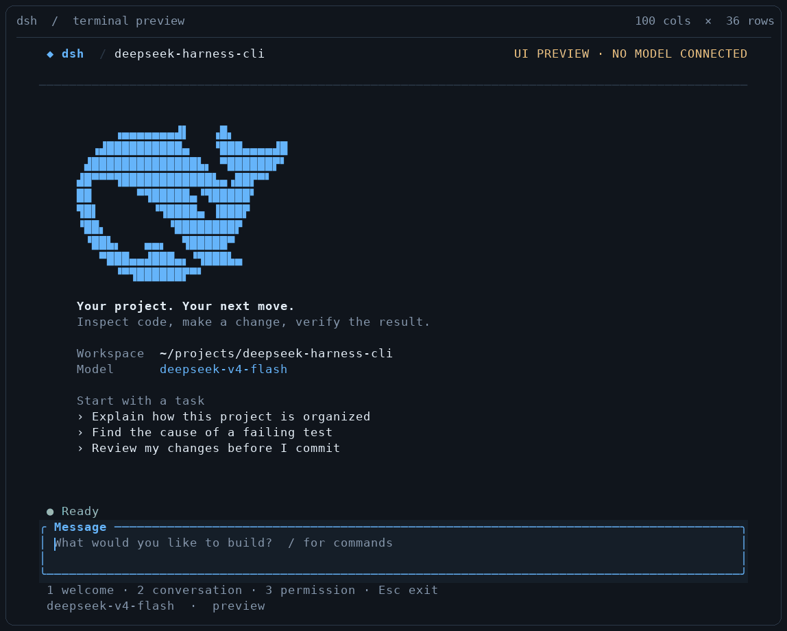
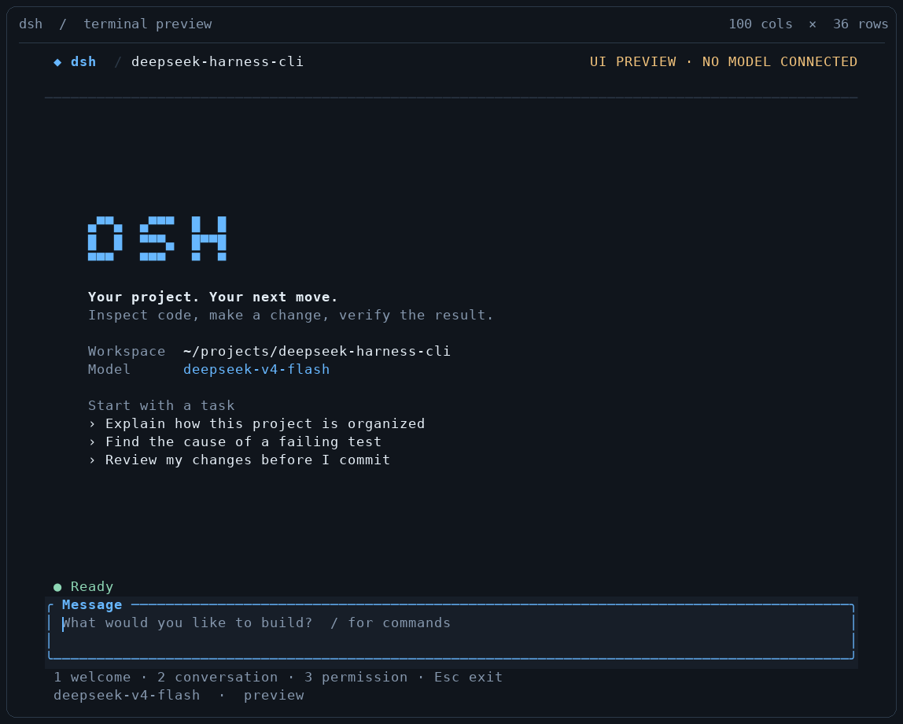
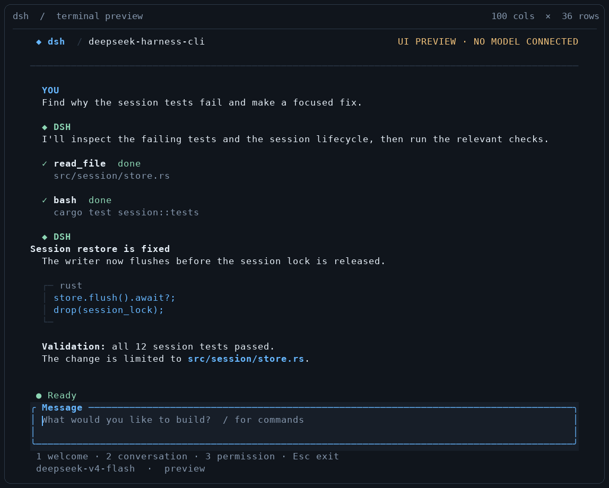
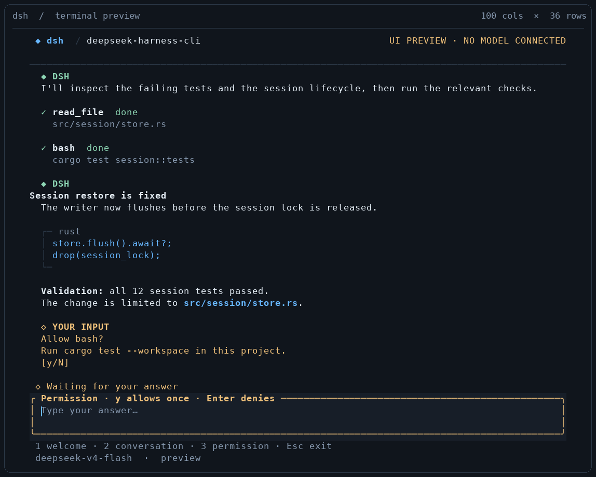

# DeepSeek Harness CLI

English | [中文](README.zh.md)

[](native/cli/README.md) [](#developer-preview) [](LICENSE)

**Your project. Your next move.**

Inspect a codebase, make changes, and work through test failures from your terminal. Install once, open a project, and type **`dsh`**.

This independent fork of [DeepSeek Harness](https://github.com/deepseek-ai/deepseek-harness) pairs a native **Rust + Ratatui** interface with the existing Node.js agent engine. Tools and persisted sessions stay in the harness; your workspace stays in the terminal.

[Quick start](#quick-start) · [Daily workflow](#daily-workflow) · [Screenshots](#screenshots) · [CLI reference](native/cli/README.md) · [Report an issue](https://github.com/Liohtml/deepseek-harness-cli/issues)



*Recorded from the real `dsh --demo` interface. Messages and tool results are sample data; no model request is made. Prefer a still image? [Open the conversation screenshot](docs/assets/cli/conversation.png).*

<a id="terminal-coding-agent"></a>

## Built for terminal work

| Stay focused | Stay in control |
|---|---|
| **Streaming conversation** — follow answers as they arrive, with code blocks and a scrollable transcript. | **Visible tool activity** — inspect tool arguments, results, and failures with `Ctrl+T`. |
| **A proper composer** — multiline input, Unicode, bracketed paste, and prompt history. | **Explicit approvals** — dedicated permission prompts; Enter rejects a request. |
| **Commands within reach** — type `/`, select with arrow keys, and complete with Tab. | **Sessions you can resume** — use `/session` to get the current id and resume command. |

<a id="run"></a><a id="run-from-source"></a>

<a id="quick-start"></a>

## Quick start

You need **Rust 1.88+ with Cargo**, **Node.js `^22.19` or `>=24`**, and **pnpm** (the version is pinned in `package.json`). The shell installer supports Linux and macOS; see the [installation reference](native/cli/README.md) for Windows and custom paths.

Build and install this fork:

```sh
git clone https://github.com/Liohtml/deepseek-harness-cli.git
cd deepseek-harness-cli
pnpm install
pnpm run build
./install.sh
export PATH="$HOME/.local/bin:$PATH"
```

Open your project and start a session:

```sh
cd /path/to/your/project
export DEEPSEEK_API_KEY='your-api-key'
dsh
```

You can also put `DEEPSEEK_API_KEY` in your project's `.env`. Keep the built checkout: the installed executable uses its Node.js runtime. Add the install directory to your shell's PATH configuration for future terminals. The [installation reference](native/cli/README.md) covers runtime paths and selecting the right `dsh` when multiple versions are installed.

**Want to explore the interface first?** After installation, run `dsh --demo` without an API key. Press `1` for the welcome screen, `2` for a sample conversation, `3` for a permission prompt, and Esc to exit.

<a id="daily-workflow"></a>

## Daily workflow

```sh
dsh                                      # Work in the current project
dsh --cwd /path/to/project               # Open another project
dsh --resume session-…                   # Continue a saved session
dsh headless "Run tests and summarize failures"  # One task, then exit
```

Start with a concrete task:

> Explain how this project is organized and where requests enter the system.

> Find the cause of the failing tests, make a focused fix, and run the relevant checks.

> Review my uncommitted changes for bugs and missing error handling.

Use `/session` to find your resume command and `/exit` to close the session. Resume from the same project directory. For scripts and pipes, select `headless` explicitly; the interactive interface needs a real terminal.

### Keyboard essentials

| Key | What it does |
|---|---|
| Enter | Send a message or answer |
| Alt+Enter / Ctrl+J | Add a newline |
| ↑ / ↓ | Browse prompt history |
| PgUp / PgDn | Scroll the conversation |
| Ctrl+T | Expand or collapse tool details |
| F1 / F2 | Open keyboard help / runtime diagnostics |
| Ctrl+C | Stop the current turn; exit when idle |
| Ctrl+D | Close the session |

See the [complete terminal reference](native/cli/README.md) for commands, permissions, and input behavior.

<a id="screenshots"></a>

## Screenshots

The images below come from the same offline demo as the GIF. Click an image to view it at full resolution.

<details>
<summary><strong>Welcome — your workspace, model, and next task</strong></summary>

[](docs/assets/cli/welcome.png)

</details>

<details>
<summary><strong>Conversation — answers, code, and tool activity</strong></summary>

[](docs/assets/cli/conversation.png)

</details>

<details>
<summary><strong>Permissions — review a request before allowing it</strong></summary>

[](docs/assets/cli/approval.png)

</details>

<a id="developer-preview"></a>

## Developer preview

This fork is in **developer preview**. Interfaces and compatibility may change. Read the [safety notice](SAFETY.md) before running an agent in your projects.

The frontend is native Rust; running the agent still requires Node.js and the built checkout. The upstream npm package does not include this fork's terminal interface. For startup problems, open diagnostics with F2 and consult [build and runtime troubleshooting](native/cli/README.md).

## Other interfaces

<details>
<summary>Use the Web UI or the Node.js frontend</summary>

From this built checkout, `pnpm dsh` opens the plain Node.js terminal frontend; `pnpm dsh web` starts the Web UI without rebuilding. With the Rust executable installed, `dsh web` also forwards to the web profile.

<a id="run-from-npm"></a>

To try the upstream Web UI through npm:

```sh
npx @deepseek-ai/dsh web
```

It serves `http://127.0.0.1:3080` by default and opens a browser on local launch. SSH launches print the URL; your SSH client or editor handles port forwarding. Pass `--no-open` to suppress browser launch. See the [Web UI guide](docs/user/guide/index.md).

</details>

## Community and support

- **This CLI:** [bug reports and feature requests](https://github.com/Liohtml/deepseek-harness-cli/issues).
- **Upstream harness:** [Discussions](https://github.com/deepseek-ai/deepseek-harness/discussions) and [Discord](https://discord.gg/4MrtZUhpxg).
- **Plugins:** add the [`dsh-plugin`](https://github.com/topics/dsh-plugin) topic to help others discover your extension.

## Contributing

Start with [CONTRIBUTING.md](CONTRIBUTING.md), the [development guide](docs/development.md), and the [native frontend guide](native/cli/README.md). Agents should read [AGENTS.md](AGENTS.md). README media can be regenerated with the [capture script](native/cli/tools/capture_demo.py).

<a id="development"></a>

## Built on DeepSeek Harness

[DeepSeek AI](https://deepseek.com) develops the upstream harness. Its **everything-is-a-plugin** architecture is powered by [Cordis](https://github.com/cordiverse/cordis), described in [*A Programming Paradigm for Spatiotemporal Composability*](https://arxiv.org/abs/2608.25512). Explore the [architecture](docs/architecture.md) and [upstream documentation](https://deepseek-harness.github.io/deepseek-harness/) for the underlying engine.

<a id="citation"></a>

<details>
<summary>Cite the upstream project</summary>

```bibtex
@misc{deepseek-harness2026,
  title={DeepSeek Harness: Everything is a Plugin},
  author={DeepSeek-AI},
  year={2026},
  publisher={GitHub},
  howpublished={\url{https://github.com/deepseek-ai/deepseek-harness}},
}
```

</details>

## License

[MIT](LICENSE). See [third-party notices](THIRD_PARTY_NOTICES.md) for dependency licenses.
